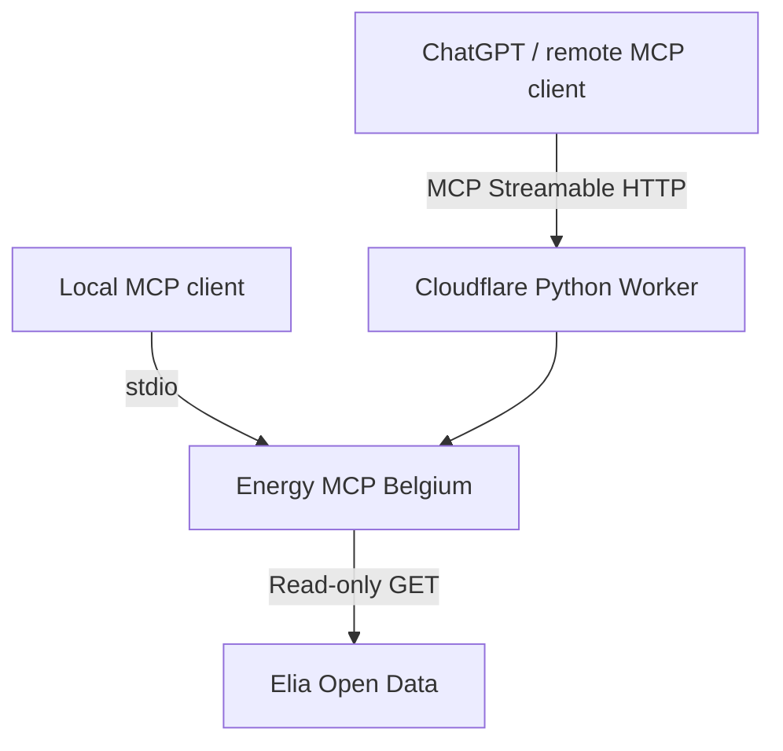

# ⚡ Energy MCP Belgium 🇧🇪

**Structured Belgian electricity-system data for MCP-compatible AI applications.**

Energy MCP Belgium exposes read-only MCP tools backed by Elia Open Data, so compatible AI applications can retrieve Belgian generation, load, imbalance and price data without implementing Elia-specific APIs and schemas. The host handles natural language; the server provides structured data and deterministic calculations.

**8 MCP tools · 6 Elia datasets · Read-only · Open source**

## Two ways to use it

### Option 1 — Run locally

Install the [production PyPI package](https://pypi.org/project/energy-mcp-belgium/), requiring Python 3.11+:

```sh
pip install energy-mcp-belgium
energy-mcp-belgium
```

This starts local **stdio MCP** and waits for an MCP client, not a chat prompt.

### Option 2 — Connect remotely

**Remote MCP:** A hosted demo endpoint is available for trying Energy MCP Belgium with compatible MCP clients over **Streamable HTTP**:

```text
https://energy-mcp-belgium.junaidbashir392.workers.dev/mcp
```

See [client setup](docs/clients.md#remote-streamable-http) for connection instructions and [service limits](docs/remote-security.md#service-availability) for availability and retry guidance.



## Local client setup

Requires Python 3.11+. Install from [PyPI](https://pypi.org/project/energy-mcp-belgium/):

```sh
python -m venv .venv
# Activate the environment: see commands below.
python -m pip install energy-mcp-belgium
energy-mcp-belgium
# Equivalent: python -m energy_mcp_belgium
```

Activate with `.venv\Scripts\Activate.ps1` in PowerShell, or `source .venv/bin/activate` in a POSIX shell. The server uses **stdio**: a bare launch waits for MCP input; it is not an interactive chat prompt. No LLM API key is required. To install from a downloaded or cloned source checkout instead, use `python -m pip install .`.

Configure your MCP host to launch the installed command:

```json
{
  "mcpServers": {
    "energy-belgium": {"command": "energy-mcp-belgium", "args": []}
  }
}
```

The configuration envelope depends on the host. Ensure its PATH includes your environment's executable directory; otherwise use your own absolute installed executable path. See [client setup](https://github.com/Junaid-Bashir/energy-mcp-belgium/blob/main/docs/clients.md) and the [Inspector example](https://github.com/Junaid-Bashir/energy-mcp-belgium/blob/main/examples/inspector-config.json).

## Use with ChatGPT

Use the hosted endpoint with ChatGPT to retrieve structured Elia data and run deterministic energy and quality calculations.

For accounts/workspaces with custom MCP creation permission, the current [OpenAI connection guide](https://help.openai.com/en/articles/12584461-connecting-custom-mcp-servers-in-chatgpt) describes:

1. Open [ChatGPT Plugins](https://chatgpt.com/plugins), select **+**, then **Add custom MCP server**.
2. Enter a name and the HTTPS MCP endpoint shown above; select **No authentication** for this public-data server.
3. Review the custom-server risk warning, then choose **Create as a plugin** and inspect the eight discovered tools.
4. Enable the connection in a conversation and ask a dated, bounded question such as the examples below.

Availability and controls depend on plan, workspace permissions and rollout. The current Plugins flow does not require enabling Developer Mode first; legacy Apps controls differ. Follow the linked official instructions for your surface rather than assuming every account has the same UI. The [client guide](docs/clients.md#remote-streamable-http) also provides a tested Inspector command without assuming a universal client configuration format.

## Tools

| Tool | Purpose |
|---|---|
| `get_solar_generation` | Belgian national measured/upscaled PV power, MW |
| `get_wind_generation` | Total, onshore or offshore measured/upscaled wind power, MW |
| `get_load` | Belgian total load including estimated losses, MW |
| `get_generation_mix` | Control-area generation preserving both official fuel classifications, MW |
| `get_system_imbalance` | Physical instantaneous imbalance, MW: positive surplus / negative shortage |
| `get_imbalance_prices` | Settlement and distinct marginal activation prices, EUR/MWh |
| `calculate_energy` | Fetch solar/wind/load power and integrate observed energy, MWh |
| `check_data_quality` | Fetch one series and diagnose coverage, gaps, nulls and grid integrity |

## Elia source contracts

| Capability | Dataset | Resolution | Unit |
|---|---|---|---|
| National PV generation | `ods209` | 15 min | MW |
| Total/onshore/offshore wind | `ods031` | 15 min | MW |
| Belgian total load | `ods001` | 15 min | MW |
| Generation by both fuel classifications | `ods201` | 15 min | MW |
| Physical system imbalance | `ods126` | 1 min | MW |
| Settlement and distinct marginal prices | `ods134` | 15 min | EUR/MWh |

Source: [Elia Open Data](https://opendata.elia.be/). See [contract details and caveats](docs/elia-data.md). No Elia endorsement is implied.

## Energy semantics matter

“What was Belgium's imbalance?” can mean two different quantities:

| Meaning | Unit | Tool |
|---|---|---|
| Physical system imbalance: positive surplus / negative shortage | MW | `get_system_imbalance` |
| Imbalance settlement price | EUR/MWh | `get_imbalance_prices` |

Ask for **MW** or **EUR/MWh** explicitly. A compatible host can clarify an ambiguous question before selecting a tool; dialogue and tool selection depend on the host/model. Instantaneous physical imbalance is not integrated as energy.

**Power is MW; energy is MWh.** `calculate_energy` fetches solar/wind/load power and integrates it deterministically in Python. The language model does not need to perform the arithmetic; the result includes coverage and does not fill missing intervals.

## Example

A host can translate “Get Belgian solar generation on 17 November 2026, 10:00–11:00 UTC” into:

```json
{
  "name": "get_solar_generation",
  "arguments": {"start": "2026-11-17T10:00:00Z", "end": "2026-11-17T11:00:00Z"}
}
```

Abbreviated structured response; the first record is shown:

```json
{
  "metadata": {"source": "elia", "dataset_id": "ods209", "unit": "MW", "timezone": "UTC", "resolution_minutes": 15, "record_count": 4},
  "records": [{"timestamp": "2026-11-17T10:00:00Z", "values": {"generation_mw": 293.89}, "dimensions": {"region": "Belgium", "gridconnectiontype": "Total"}, "quality_status": null}]
}
```

The [four-record example](https://github.com/Junaid-Bashir/energy-mcp-belgium/blob/main/docs/examples/solar-response.json) was retrieved from Elia on 19 November 2026 and may be revised. Complete responses also contain source URL, retrieval time, query bounds, null counts, status and caveats. See the [tool reference](https://github.com/Junaid-Bashir/energy-mcp-belgium/blob/main/docs/tools.md).

Other requests for a compatible host:

- Get Belgian solar generation between 10:00 and 12:00 UTC on 17 November 2026.
- How much solar **energy** was produced between 12:00 and 13:00 UTC on that date?
- What was the Belgian system imbalance **in MW** during that hour?
- What was the Belgian imbalance **price** during that hour?
- Compare Belgian solar and total wind generation over that period.
- Is the Belgian total-load series complete for that period?

## Compatibility and validation

Tested with the official MCP Inspector, local stdio clients and ChatGPT over hosted Streamable HTTP. Validation covers all eight tool schemas, bounded real Elia queries, deterministic analytics and input/error handling.

[Validation methodology](docs/validation.md) · [Deployment guide](docs/remote-mcp.md) · [Hosted security and service limits](docs/remote-security.md) · [Local demo](docs/demo.md)

## Time and calculations

Use ISO 8601 with `Z` or an explicit UTC offset, UTC quarter-hour aligned boundaries, **inclusive start / exclusive end**, and **at most 24 elapsed hours** per request. Bounds protect provider infrastructure and client context; nothing is silently truncated. Naive timestamps and numeric Unix timestamps are rejected.

Belgian local days may contain **92, 96 or 100 quarter-hours**. Calculations use UTC elapsed time. Split a 25-hour autumn day into requests of at most 24 hours. See [time semantics](https://github.com/Junaid-Bashir/energy-mcp-belgium/blob/main/docs/time-semantics.md).

`calculate_energy` fetches its own solar/wind/load source and computes MW × interval hours → MWh in Python. Missing intervals are not filled; coverage accompanies observed energy. Duplicate or irregular timestamps are rejected where integration would be ambiguous. `check_data_quality` reports expected/received intervals, missing intervals, nulls, duplicate timestamps, off-grid records, coverage and status. Availability is separate from physical plausibility and provider validation. See [analytics](https://github.com/Junaid-Bashir/energy-mcp-belgium/blob/main/docs/analytics.md).

## Limitations

- Only Elia is supported, through local stdio and hosted Streamable HTTP MCP. No forecasts, weather, market actions or SolarCast integration are implemented.
- Solar uses ods209 from **26 October 2026**; legacy solar stitching is not implemented.
- Historical records can lag, contain nulls or be revised. Separate calls do not share an immutable snapshot.
- Detailed results can be large: a measured 24-hour generation-mix response contained 1,152 records and approximately **534 KB** of MCP result. Prefer one-hour windows for mix and minute imbalance, or analytics when only totals/coverage are needed.
- Tool selection and free-text answers depend on the MCP host and model. See [client compatibility](docs/clients.md) and [validation methodology](docs/validation.md).

## Hosted limits and privacy

The hosted demo is best-effort, with no SLA. Requests are rate limited, and users behind the same egress address may share a budget. On HTTP 429, honor `Retry-After` (currently 60 seconds); on an upstream capacity error, wait at least 60 seconds and reduce frequency/window size. Do not retry in a loop. Resource limits can also cause HTTP 503 / Cloudflare 1102 errors. Use local stdio for repeated or sustained access if these errors recur. See the [exact maintainer policy](docs/remote-security.md).

Operational telemetry intentionally excludes prompts, conversation content, raw arguments, full time-series responses, cookies and authorization headers. Persisted Worker invocation/application logs and tracing are disabled. Cloudflare and the chosen MCP host still apply their own platform data handling; this is not a claim of anonymous or zero-retention service.

## Security

The current tools are read-only: no trading, nominations, Elia writes, filesystem, shell, arbitrary HTTP destinations or code execution. Read the [security policy and vulnerability reporting guidance](SECURITY.md).

## Why this exists

Belgian electricity data is published through provider-specific datasets, fields, units and time conventions. Energy MCP Belgium provides a standard tool interface so compatible applications do not need to reimplement those details. Numerical integration belongs in deterministic code rather than model arithmetic.

## Documentation and contributing

- [Release procedure](https://github.com/Junaid-Bashir/energy-mcp-belgium/blob/main/docs/releasing.md) (TestPyPI validation and production publishing)
- [Getting started](https://github.com/Junaid-Bashir/energy-mcp-belgium/blob/main/docs/getting-started.md), [client setup](https://github.com/Junaid-Bashir/energy-mcp-belgium/blob/main/docs/clients.md), [tool reference](https://github.com/Junaid-Bashir/energy-mcp-belgium/blob/main/docs/tools.md)
- [Elia contracts](https://github.com/Junaid-Bashir/energy-mcp-belgium/blob/main/docs/elia-data.md), [time semantics](https://github.com/Junaid-Bashir/energy-mcp-belgium/blob/main/docs/time-semantics.md), [analytics](https://github.com/Junaid-Bashir/energy-mcp-belgium/blob/main/docs/analytics.md)
- [Architecture](https://github.com/Junaid-Bashir/energy-mcp-belgium/blob/main/docs/architecture.md), [sources](https://github.com/Junaid-Bashir/energy-mcp-belgium/blob/main/docs/research.md), [validation examples](https://github.com/Junaid-Bashir/energy-mcp-belgium/blob/main/docs/validation.md)
- [Contributing](https://github.com/Junaid-Bashir/energy-mcp-belgium/blob/main/CONTRIBUTING.md), [security](https://github.com/Junaid-Bashir/energy-mcp-belgium/blob/main/SECURITY.md), [third-party notices](https://github.com/Junaid-Bashir/energy-mcp-belgium/blob/main/THIRD_PARTY.md)

Software is **MIT licensed**. Elia data retains its own [Elia Open Data Licence](https://opendata.elia.be/pages/licence/); the software license does not cover that data. Contains information from Elia Transmission Belgium SA, normalized with attribution and provenance. No production or security certification is claimed.

## Related project

[SolarCast Belgium](https://github.com/Junaid-Bashir/solarcast-belgium) focuses on energy forecasting and model benchmarking. Energy MCP Belgium focuses on structured access to Belgian electricity-system data for MCP-compatible applications. There is no dependency or implemented integration between them.
