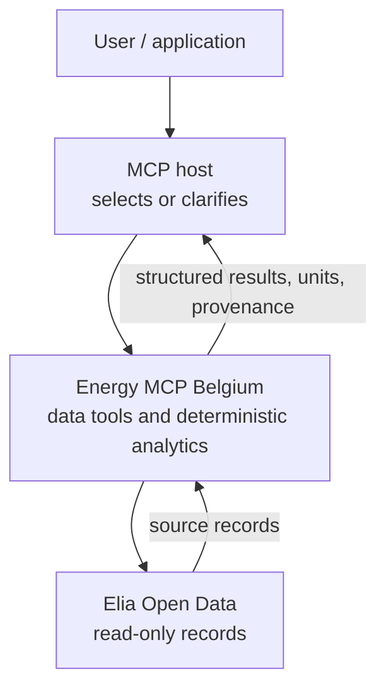

# Validation

**8 MCP tools · 6 Elia datasets · read-only data · deterministic analytics**

Energy MCP Belgium supplies structured Belgian electricity data, explicit units and source provenance. A compatible host handles natural-language questions and chooses tools. Validation covers protocol, local MCP, real Elia, Cloudflare remote MCP and ChatGPT layers; none is MCP or Elia certification, sponsorship or endorsement.

```text
1. MCP protocol: discovery, schemas and tool calls
                         ↓
2. Elia provider: bounded real records and data contracts
                         ↓
3. MCP host: natural-language selection and clarification
```

## 1. MCP protocol

The official **MCP Inspector CLI 2.16.0** (Node **22.23.4**) discovered all eight tools through `tools/list`. Generated input/output schemas were inspected and actual `tools/call` responses exercised, including a clean installed-wheel server launched outside the checkout. The [schema snapshot](examples/tools-schema.json) records the observed interface; the running server is authoritative. Inspector GUI forms were not tested. Remote Streamable HTTP was subsequently tested as described below.

Twenty recorded Inspector cases cover discovery, fifteen bounded populated live calls, three invalid calls and one successful no-data query. Names, units, UTC ordering, numeric outputs and provenance were checked. See [curated Inspector results](examples/inspector-results.json) and [client setup](clients.md).

## 2. Live Elia provider data

Dataset identities below match the implemented [Elia contracts](elia-data.md). Observations were recorded on **19 November 2026**. Most source checks used 17 November, 10:00–11:00 UTC; separate bounded day probes measured response size. A live no-data query used ods126 before its documented May 2024 start.

| Capability | Elia dataset | Resolution | Live validation |
|---|---|---|---|
| National PV generation | ods209 | 15 min, MW | Observed ✓ |
| Total/onshore/offshore wind | ods031 | 15 min, MW | Observed ✓ |
| Belgian total load | ods001 | 15 min, MW | Observed ✓ |
| Generation by fuel classifications | ods201 | 15 min, MW | Observed ✓ |
| Physical system imbalance | ods126 | 1 min, MW | Observed ✓ |
| Imbalance prices | ods134 | 15 min, EUR/MWh | Observed ✓ |

Null values remain null; source fields and price concepts are not replaced with forecasts or invented categories. Empty data is distinct from provider failure. Historical records may be revised, provisional or delayed. Data source: **Elia Open Data**, under its [separate terms](../THIRD_PARTY.md).

## MCP-compatible clients

Protocol validation uses the official MCP client and Inspector. A compatible host owns natural-language interpretation, selection and narration; the server owns structured retrieval and deterministic calculations. Host/model behavior is nondeterministic and is not guaranteed across clients. ChatGPT remote interoperability is described below.

## Demo: an ambiguous word, two different quantities

```text
User: "What was Belgium's imbalance yesterday?"
                     ↓
Host: "Do you mean physical system imbalance in MW
       or imbalance settlement price in EUR/MWh?"
```

The clarification was **host/model behavior**, guided by the tool descriptions and server instructions. The server did not generate a chat reply. This matters because `get_system_imbalance` returns a physical quantity in **MW** (positive surplus, negative shortage), while `get_imbalance_prices` returns economic settlement/marginal prices in **EUR/MWh**. A host should not silently substitute one for the other.

## Demo: power is not energy

> How much solar energy did Belgium produce between 12:00 and 13:00 UTC on 17 November 2026?

```text
Host selects calculate_energy(series="solar", start, end)
                         ↓
Elia ods209 quarter-hour power records, MW
                         ↓
Deterministic sum: MW × 0.25 hours
                         ↓
energy_mwh: 2191.975
```

**Observed on 19 November 2026 for 17 November 2026, [12:00,13:00) UTC: 2191.975 MWh**, with four usable intervals and 100% coverage. This is a dated historical example, not a current value or an immutable result.

MW describes instantaneous or interval-average **power**; MWh describes **energy over time**. `calculate_energy` fetches its own source and performs integration in Python, rather than asking the language model to do it. Missing intervals are not filled, and observed energy is accompanied by coverage. Instantaneous system imbalance is not eligible for this integration. See [analytics](analytics.md).

## Demo: is the load series complete?

For Belgian total load on **17 November 2026, [12:00,13:00) UTC**, the bounded check returned the following excerpt, verified on 19 November:

```json
{
  "record_count": 4,
  "expected_intervals": 4,
  "missing_intervals": 0,
  "null_intervals": 0,
  "duplicate_timestamps": 0,
  "off_grid_records": 0,
  "coverage_pct": 100.0,
  "status": "complete"
}
```

The complete result also carries Elia ods001 provenance, bounds, units and retrieval time. Availability is not physical plausibility or settlement validation. Duplicate logical keys and irregular timestamps fail before ambiguous integration; the tools do not silently repair records.

## Demonstration architecture



The host owns natural language; the server owns data contracts and deterministic calculations. No LLM provider is a dependency of the server. The original terminal demo uses local stdio; the hosted path below adds Streamable HTTP without changing the tools.

## Cloudflare remote MCP and ChatGPT

```text
Protocol → local stdio MCP → real Elia provider contracts
                                ↓
ChatGPT → MCP Streamable HTTP → Cloudflare → Energy MCP Belgium → Elia Open Data
```

On 21 November 2026, official Inspector 2.16.0 initialized the deployed endpoint, discovered all eight schemas matching the released stdio baseline, and retrieved a real solar interval. An earlier hosted campaign exercised all eight tools, including six datasets, energy and quality. The [remote guide](remote-mcp.md) records those scenarios and their limitations.

After hardening, actual ChatGPT conversations exercised 17 November 2026 UTC data:

| Scenario | Observed result |
|---|---|
| Solar 10:00–12:00 | Eight quarter-hour MW records, no missing records |
| Solar energy 12:00–13:00 | 2,191.975 MWh, four usable intervals, 100% coverage |
| Ambiguous Belgian imbalance | Host asked physical MW versus price EUR/MWh before retrieval |
| Solar versus total wind 12:00–16:00 | Both power series retrieved, 16 records each, 100% coverage |

Sanitized operational events corroborated the retrieval/analytics calls. Host/model selection and narration remain nondeterministic. A separately recorded price demonstration included a host-mentioned web search; it is not described as exclusively MCP-only. No account identifiers, private conversation URLs or raw traces are included here.

**Current operational status: not ready for public demonstration.** The hosted service uses Workers Free (10 ms CPU/request). The deployed hardening version showed 39.02 ms median CPU in dashboard observations; controlled remote discovery encountered HTTP 503 / Cloudflare 1102 before an HTTP 429 could be observed. Testing stopped immediately. Local native-runtime testing returned 429 on request 61 after 60 successful discovery calls, with Retry-After 60 and no Elia traffic. This proves the local policy, not completion of the remote quota test. See the [capacity gate and full security policy](remote-security.md#runtime-capacity-is-a-separate-public-readiness-gate).

Successful end-to-end scenarios do not establish uptime, load capacity or a certification. Resolve capacity and repeat the bounded remote quota test before promoting the hosted endpoint. Local stdio remains available independently.

## Run the public demo

The [public demo guide](demo.md) provides one reproducible command, five sequential one-hour scenarios, concise terminal output and optional local JSON evidence. It requires an installed package and explicit **ENERGY_MCP_LIVE=1**; without it no provider call is made. Generated summaries are ignored, not automatically committed. For recording, use the [15–30 second shot list](recording.md).

## Context size

Measured compact UTF-8 JSON, excluding JSON-RPC framing. Full MCP result includes the SDK's text content and structuredContent, so it is larger than the structured payload alone. These are dated observations, not fixed response-size guarantees.

| Series | 1h records | 1h structured / MCP bytes | 24h records | 24h structured / MCP bytes |
|---|---:|---:|---:|---:|
| Solar | 4 | 1,054 / 2,827 | 96 | 15,094 / 41,795 |
| Wind total | 4 | 945 / 2,549 | 96 | 12,958 / 35,965 |
| Load | 4 | 882 / 2,331 | 96 | 11,047 / 29,931 |
| Generation mix | 48 | 8,751 / 23,379 | 1,152 | 199,367 / 534,101 |
| Imbalance prices | 4 | 1,361 / 3,405 | 96 | 22,433 / 55,445 |
| System imbalance | 60 | 8,096 / 21,303 | not measured here | not measured here |

Prefer short windows for mix and minute imbalance. Use energy/quality tools when only totals or coverage are needed. The maximum 24-hour bound prevents uncontrolled downloads but does not guarantee a comfortable model context. No records are silently truncated.

## Reproduce validation

| Layer | Reproduction path |
|---|---|
| Protocol | Follow [Inspector setup](clients.md); run `tools/list`, inspect schemas, then bounded `tools/call` |
| Offline | `python -m pytest -q` after [development setup](../CONTRIBUTING.md) |
| Provider | Explicitly enable `ENERGY_MCP_LIVE=1`, then `python -m pytest tests/test_live.py -m live -s` |
| Public demo | Enable the same variable, then `python examples/run_public_demo.py` |
| Host | Configure a compatible host using the [client example](clients.md); ask the dated scenario questions and observe actual calls/clarification |

Offline tests use synthetic provider-shaped records and the official MCP client. Four 100 MW quarter-hours yield exactly 100 MWh. Coverage, missing/null values, duplicates, irregular timestamps and 92/96/100-interval DST days are exercised. Default tests block unmarked provider HTTP; normal CI does not depend on Elia, Inspector downloads or model access. Clean-wheel checks launch the installed server outside the checkout and block provider HTTP during startup/discovery.

## Limitations and attribution

Observed client/model scenarios do not establish reliability for every model. Other hosts can behave differently. Historical values may change; full-day mix and minute imbalance can consume substantial context. Local stdio and remote HTTP scenarios were validated; Inspector GUI forms were not. The remote CPU capacity gate remains unresolved. Tests demonstrate observed interoperability, not certification or production/security guarantees.

The [four-record solar response](examples/solar-response.json) is an intentionally tiny, dated example with Elia attribution and provenance. No bulk live dataset or raw host transcript is published. See [data terms](../THIRD_PARTY.md), [security](../SECURITY.md), and [time semantics](time-semantics.md).
